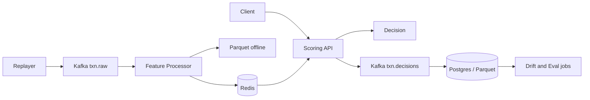

# RiskGate

Real-time payment risk scoring platform (portfolio project): Kafka-streamed features, ONNX serving, shadow challengers, drift monitoring, and MLflow — evaluated with PR-AUC and cost-based thresholds on IEEE-CIS.

## Phase 1 quickstart

```bash
# Install uv: https://docs.astral.sh/uv/
make sync
cp .env.example .env
make download-data    # needs Kaggle credentials for kagglehub
make train-baseline
make eval             # -> results/baseline.json
make test
make lint
make typecheck
```

Optional local infra (Kafka, Redis, Postgres, MLflow, Prometheus, Grafana):

```bash
make up
```

## Measured results

After `make eval`, see **`results/baseline.json`** for PR-AUC, recall @ 1% FPR, calibration, and confusion counts. Do not cite numbers until that file exists on your machine.

Documentation: [docs/EVALUATION.md](docs/EVALUATION.md), [docs/adr/](docs/adr/README.md).

## Architecture (target state)



Phase 1 implements offline training and evaluation only; streaming and serving follow in later phases.
